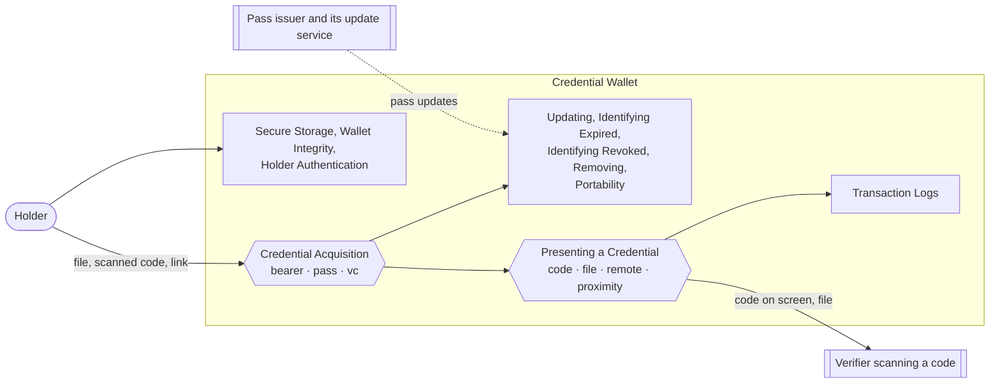

## Why choose this conformance profile?

Every conformant wallet meets this profile. It is what makes a product a wallet rather than a key store: the wallet holds credentials that someone other than the holder has signed, checks them before keeping them, keeps them secure, and presents them only with the holder's consent. It names no protocol and needs no issuer or verifier that follows one, so a wallet can meet it on its own.

A wallet chooses which credential types it handles and how it presents them. It meets at least one option of Credential Acquisition (`bearer`, `pass`, or `vc` by claiming the Verifiable Credentials profile) and at least one option of Presenting a Credential (`code`, `file`, or the Remote Presentation or Proximity Presentation profile). Every credential type it acquires must be presentable through a presentation option it meets.

## Example use cases

* **Event tickets and boarding passes.** A transport operator issues boarding passes as PKPASS files; travellers add them to a wallet and show the code at the gate.
* **Signed health certificates.** A ministry of health issues certificates as signed QR codes; the holder scans the code into the wallet and shows it when asked.
* **Membership cards.** A library issues membership cards as passes, updated through the pass's update service when the membership is renewed.
* **A credentials ecosystem.** A national wallet holds identity credentials and driving licences obtained over OpenID4VCI, and presents them online and in person, by also claiming the extensions.

## Functionalities

| Functionality | Realises | Description |
|---|---|---|
| [Secure Storage](functionalities/secure-storage.md) | Secure Credential Custody | Credentials and the keys that protect them are stored so that they cannot be read, copied or changed by anyone other than the holder through the wallet. |
| [Wallet Integrity](functionalities/wallet-integrity.md) | Secure Credential Custody | The wallet can show that it is a genuine instance of its wallet solution, and stops working with credentials when its provider revokes it. |
| [Holder Authentication](functionalities/holder-authentication.md) | Secure Credential Custody, Holder Control | The wallet knows that the person using it is the holder before it does anything with their credentials. |
| [Credential Acquisition](functionalities/credential-acquisition.md) | Credential Collection | The holder can add credentials of at least one credential type to the wallet. |
| [Updating Credentials](functionalities/updating-credentials.md) | Credential Currency | When the issuer changes a credential, the holder gets the new version without starting over. |
| [Identifying Expired Credentials](functionalities/identifying-expired-credentials.md) | Credential Currency | The holder knows which credentials are past their validity period, and is warned before a credential expires. |
| [Identifying Revoked Credentials](functionalities/identifying-revoked-credentials.md) | Credential Currency | The holder knows which credentials the issuer has revoked or suspended. |
| [Removing a Credential](functionalities/removing-a-credential.md) | Holder Control | The holder can remove any credential from the wallet at any time. |
| [Portability](functionalities/portability.md) | Holder Control | The holder can move their credentials to another device and keep using them. |
| [Presenting a Credential](functionalities/presenting-a-credential.md) | Credential Presentation, Holder Control | The holder presents a credential only at their direction and with their consent, and can present every type of credential they hold. |
| [Transaction Logs](functionalities/transaction-logs.md) | Holder Control | The holder can see everything the wallet has done with their credentials, with timestamps. |
| [Wallet as Authenticator](functionalities/wallet-as-authenticator.md) | Online Authentication | Roadmap. The holder logs in to online services with the wallet. |
| [Signing with the Wallet](functionalities/signing-with-the-wallet.md) | Document Signing | Roadmap. The holder signs documents with keys held in the wallet. |

*Figure: functionality map of the Credential Wallet profile. Hexagons are variation points. The `vc`, remote and proximity options are met by claiming the extensions.*

## Actors relevant for testing

| Actor | Kind | Role in tests | Functionalities | Specified where |
|---|---|---|---|---|
| Holder | Person | Adds, approves, presents and removes credentials | All | This specification |
| Bearer credential issuer | System | Supplies signed codes and files, as fixtures | Credential Acquisition | The format's own standard (for example EU DCC, ICAO VDS) |
| Pass issuer | System | Supplies PKPASS files and links, and an update service | Credential Acquisition, Updating Credentials, Identifying Revoked Credentials | PKPASS format, not specified here |
| Verifier scanning a code | System | Reads a code shown on screen | Presenting a Credential | Not specified |

## Interfaces

| Interface | Counterpart | Direction | Functionalities | Type | Contract defined in |
|---|---|---|---|---|---|
| Credential files and codes | Bearer credential issuer, pass issuer | Inbound | Credential Acquisition | File | The format's own standard |
| Pass update service | Pass issuer | Outbound | Updating Credentials | Consumed API | PKPASS web service |
| Code on screen | Verifier | Outbound | Presenting a Credential | User interface | The format's own standard |
| Credential file sharing | Verifier | Outbound | Presenting a Credential | File | The format's own standard |
| Export and backup | Holder, another device | Outbound | Portability | File | This specification |
