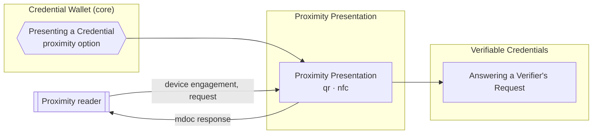

## Why choose this conformance profile?

Choose it for a wallet whose holders prove facts in person, where neither side may be online: roadside checks, access gates, age checks at a counter. A wallet that claims it meets the proximity presentation option of Presenting a Credential in the core, and must also claim Verifiable Credentials. Because ISO/IEC 18013-5 carries mdoc only, the profile requires the wallet to accept mdoc credentials. Answering a Verifier's Request, Privacy-preserving Presentation, Complaint Submission and Data Deletion Request then apply to it.

## Example use cases

* **Roadside check.** A police officer's reader scans the QR code the wallet shows and receives the driving licence over Bluetooth Low Energy.
* **Access gate.** An employee taps the phone on an NFC reader at the office gate.
* **Age check.** A shop assistant checks that a customer is over 18 without seeing their name or address.

## Functionalities

| Functionality | Realises | Description |
|---|---|---|
| [Proximity Presentation](functionalities/proximity-presentation.md) | Credential Presentation | The holder presents credentials in person, without either side being online, over NFC or Bluetooth Low Energy as specified in ISO/IEC 18013-5. |

*Figure: functionality map of the Proximity Presentation profile, with the functionalities it builds on.*

## Actors relevant for testing

| Actor | Kind | Role in tests | Functionalities | Specified where |
|---|---|---|---|---|
| Proximity reader | Device | Engages the wallet by QR code or NFC, and requests and checks mdoc data | Proximity Presentation | ISO/IEC 18013-5 |

## Interfaces

| Interface | Counterpart | Direction | Functionalities | Type | Contract defined in |
|---|---|---|---|---|---|
| ISO/IEC 18013-5 device retrieval | Proximity reader | Inbound request, outbound response | Proximity Presentation | Protocol | ISO/IEC 18013-5 |
| NFC engagement | Proximity reader | Inbound | Proximity Presentation | Device | ISO/IEC 18013-5 |
