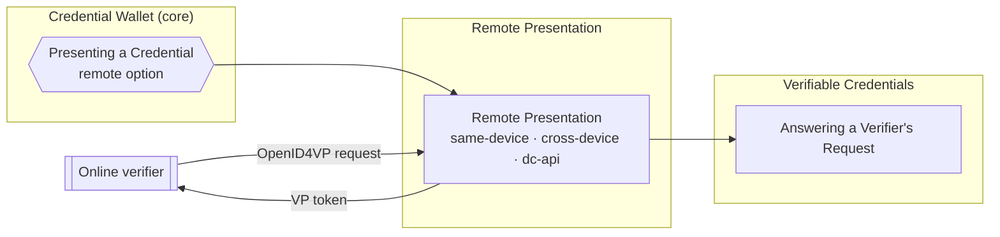

## Why choose this conformance profile?

Choose it for a wallet whose holders prove facts to online services: opening a bank account, applying for a benefit, logging in to a portal. A wallet that claims it meets the remote presentation option of Presenting a Credential in the core, and must also claim Verifiable Credentials. Answering a Verifier's Request, Privacy-preserving Presentation, Complaint Submission and Data Deletion Request in that profile then apply to it.

## Example use cases

* **Same-device presentation.** A citizen applies for a benefit on their phone, and the portal asks the wallet on the same phone for an identity credential.
* **Cross-device presentation.** A customer opens a bank account on a laptop, scans the QR code the bank shows, and presents from the phone.
* **Browser presentation.** A service asks for a credential through the W3C Digital Credentials API (roadmap).

## Functionalities

| Functionality | Realises | Description |
|---|---|---|
| [Remote Presentation](functionalities/remote-presentation.md) | Credential Presentation | The wallet presents verifiable credentials to an online verifier over OpenID4VP, on the same device or from another device. |

*Figure: functionality map of the Remote Presentation profile, with the functionalities it builds on.*

## Actors relevant for testing

| Actor | Kind | Role in tests | Functionalities | Specified where |
|---|---|---|---|---|
| Online verifier | System | Sends OpenID4VP requests and checks the responses, as a conformant verifier would | Remote Presentation | `govstack:ra:credentials`, OpenID4VP |

## Interfaces

| Interface | Counterpart | Direction | Functionalities | Type | Contract defined in |
|---|---|---|---|---|---|
| OpenID4VP | Online verifier | Inbound request, outbound response | Remote Presentation | Protocol | OpenID4VP |
