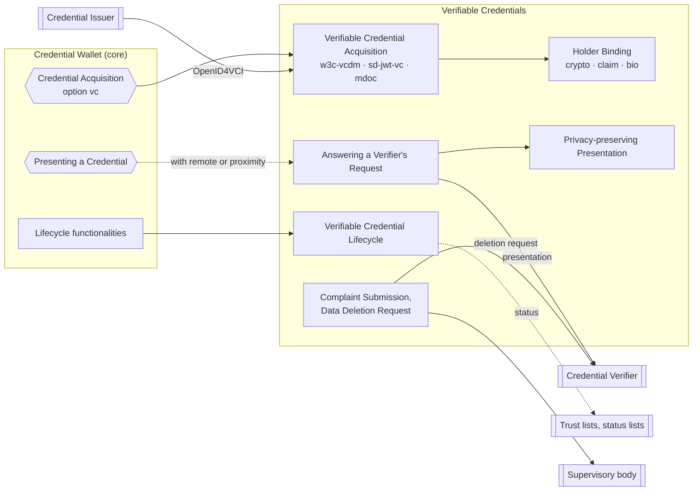

## Why choose this conformance profile?

Choose it for a wallet that takes part in a credentials ecosystem: issuers that issue over OpenID4VCI, verifiers that request presentations, and trust infrastructure that says which of them to trust. A wallet that claims it meets option `vc` of Credential Acquisition in the core, and meets the core in full.

The profile holds every OpenID4VCI requirement, workflow and data structure of the specification, holder binding, and the verifiable credential lifecycle. It also holds what every request-based presentation of a verifiable credential needs: verifier checks, nonce binding, selective disclosure, complaints and deletion requests. Those apply only when the wallet also claims Remote Presentation or Proximity Presentation. A wallet that holds verifiable credentials and shows them only as codes reports them as not applicable.

## Example use cases

* **National identity credential.** A citizen obtains an identity credential from the civil registry over OpenID4VCI, bound to a key in the phone's secure environment.
* **University diploma.** A graduate obtains a diploma as an SD-JWT VC and later shows only the degree and the year to an employer.
* **Driving licence.** A driver obtains an mdoc driving licence and presents it at a roadside check, through Proximity Presentation.
* **Signed health certificate as a VC barcode.** A wallet holds certificates whose issuer also supplied a signed code, and shows the code without claiming a request-based method.

## Functionalities

| Functionality | Realises | Description |
|---|---|---|
| [Verifiable Credential Acquisition](functionalities/vc-acquisition.md) | Credential Collection | The holder can obtain verifiable credentials from an issuer, and find out how to obtain them. |
| [Holder Binding](functionalities/holder-binding.md) | Secure Credential Custody, Credential Presentation | A verifier can check that the person presenting a credential is the person it was issued to. |
| [Verifiable Credential Lifecycle](functionalities/vc-lifecycle.md) | Credential Currency, Holder Control | What verifiable credentials add to the core lifecycle: status checks, batch copies, removal and portability. |
| [Answering a Verifier's Request](functionalities/answering-a-verifier-request.md) | Credential Presentation | The wallet presents verifiable credentials when a verifier asks for them, after checking the verifier and getting the holder's consent. |
| [Privacy-preserving Presentation](functionalities/privacy-preserving-presentation.md) | Privacy-Preserving Disclosure | The holder shares only what a transaction needs, and cannot be tracked across presentations. |
| [Complaint Submission](functionalities/complaint-submission.md) | Holder Recourse | The holder can complain about a verifier to the supervisory body responsible for it. |
| [Data Deletion Request](functionalities/data-deletion-request.md) | Holder Recourse | The holder can ask a verifier to delete credentials they presented to it earlier. |

*Figure: functionality map of the Verifiable Credentials profile, with the core functionalities it attaches to.*

## Actors relevant for testing

The core's actors are in the introduction of the Credential Wallet profile.

| Actor | Kind | Role in tests | Functionalities | Specified where |
|---|---|---|---|---|
| Credential Issuer | System | Issues credentials over OpenID4VCI, as a conformant issuer would | Verifiable Credential Acquisition, Verifiable Credential Lifecycle | `govstack:ra:credentials`, OpenID4VCI |
| Credential Verifier | System | Sends presentation requests and receives presentations | Answering a Verifier's Request, Privacy-preserving Presentation, Data Deletion Request | `govstack:ra:credentials` |
| Status list provider | System | Serves status lists | Verifiable Credential Lifecycle | The credential format's status mechanism |
| Supervisory body | Organisation | Receives complaints | Complaint Submission | Not specified |

## Interfaces

| Interface | Counterpart | Direction | Functionalities | Type | Contract defined in |
|---|---|---|---|---|---|
| Credential offer endpoint | Credential Issuer | Inbound | Verifiable Credential Acquisition | Service API | `resources/api/Credential-Offer.yaml`, OpenID4VCI |
| Credential issuance | Credential Issuer | Outbound request, inbound credential | Verifiable Credential Acquisition | Protocol | OpenID4VCI |
| Status list | Status list provider | Outbound | Verifiable Credential Lifecycle | Consumed API | The credential format's status mechanism |
| Presentation | Credential Verifier | Inbound request, outbound response | Answering a Verifier's Request | Protocol | Remote Presentation or Proximity Presentation |
