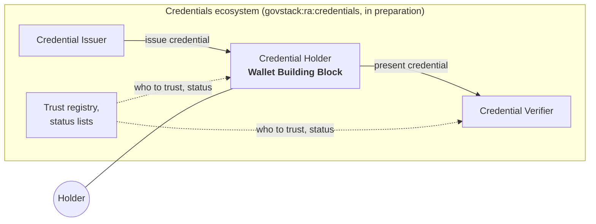
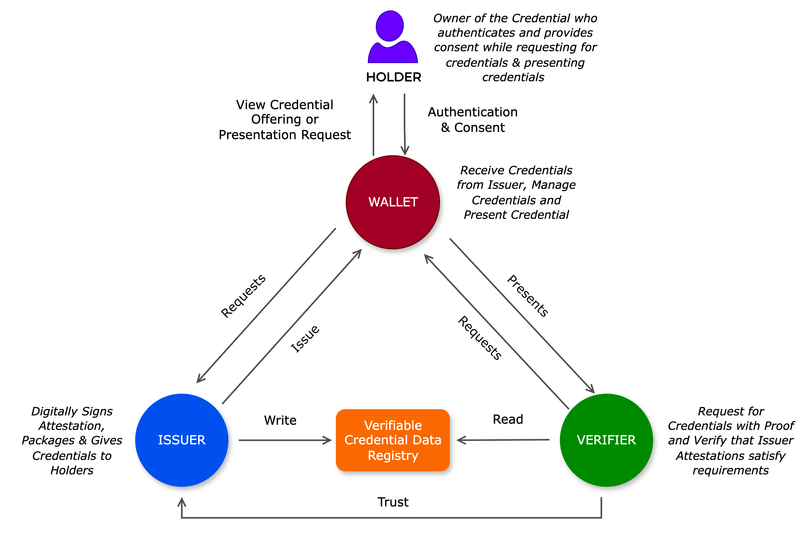

## Value

The Wallet Building Block exists so that people can keep the credentials others issue to them, such as identity documents, licences, diplomas, certificates, tickets and passes, and prove facts about themselves with those credentials, under their own control.

Today each issuer that goes digital tends to bring its own app, and each service that checks a credential has to integrate with every app its users might carry. Holders end up with a wallet per issuer, with no common guarantees about how their credentials are protected or when they are shared. A conformant wallet provides **Secure Credential Custody**, **Credential Collection**, **Credential Currency**, **Credential Presentation** and **Holder Control** to every holder. Wallets that take part in a credentials ecosystem also provide **Privacy-Preserving Disclosure** and **Holder Recourse**. **Online Authentication** and **Document Signing** are on the roadmap.

A common specification matters here because of **choice** and **interoperability**: the holder chooses the wallet, but issuers and verifiers rely on it. Without an agreed statement of what a wallet does, every issuer and every verifier must support every wallet product their citizens might pick, or force them onto one. It also gives **assurance**: a government can require conformance when it procures or certifies a wallet, and GovMarket can report which credential types, presentation methods and conformance profiles each product meets.

Privacy-Preserving Disclosure and Holder Recourse are realised only in the Verifiable Credentials conformance profile, together with Remote Presentation or Proximity Presentation. A wallet that holds only passes and bearer credentials, and presents them as codes, does not provide them.

## What a Wallet is

Wallet as a term can mean many things depending on your background and context. In this specification, a **Wallet** is a holder-bound digital vault that is capable of managing credentials and related artefacts (for example, a digital passport, passes, digital signatures) that are stored in a tamper-proof way and used in a secure manner. This definition replaces the "Container with Content" abstraction of version 1.x, as recorded in [Wallet TDR no. 03](../ADR/WALLET-TDR-2026-10-3.md).

What separates a wallet from a key store is that a wallet holds data that someone else attests about the holder: credentials signed by an issuer other than the holder. A device that holds only keys the holder generates, such as a crypto hardware wallet, is not a wallet in this sense, though it may serve as a wallet's secure component. Nor is a credential carrier, such as a QR code printed on paper: WALLET-TDR-2026-10-3 calls it a low-tech wallet, but it is not bound to the holder and holds a single credential. Low-tech wallets are out of scope unless they fulfil the definition above; the specification covers a credential carrier only as the presentation it makes.

Wallets handle different kinds of credentials. Some a wallet can handle on its own: bearer credentials, such as signed health certificates scanned from a QR code, and passes, such as tickets and boarding passes. Others need an ecosystem of issuers, verifiers and trust infrastructure that follow given protocols: verifiable credentials in formats such as the W3C Verifiable Credentials Data Model, IETF SD-JWT VC or ISO/IEC 18013-5 mdoc. The specification is designed to be independent of any single format, so that implementers can support existing and emerging standards while keeping a consistent experience for the holder.


GovStack Technical Specifications are open to multiple internationally common regulations. They do not aim for compliance to a specific regulation and allow for the freedom of local regulatory sovereignty.

Accordingly we do not within this Wallet Specification align to or preclude a particular regulatory or legal framework.

Therefore we recognise this separation of technical and regulatory requirements by implication means that an implementor will need to be aware of the need for appropriate regulatory capabilities and requirements and consider these with our technical requirements at the point of implementation.


## Place in larger systems

The Wallet Building Block operates within the GovStack Architecture and inherits its cross-functional requirements.

**The credentials ecosystem.** In the Issuer-Holder-Verifier model, the wallet performs the role of the Credential Holder's agent: it receives credentials from Credential Issuers, and presents them to Credential Verifiers at the holder's direction. A Domain Reference Architecture for this domain (`govstack:ra:credentials`) is being prepared. It will describe the issuer, verifier and trust registry roles; this specification describes only what the wallet does towards them.

Which part of the specification performs each role:

| Role towards | Exchange | Performed by |
|---|---|---|
| Holder | Adding, checking, keeping, presenting and removing credentials, with consent | The core, Credential Wallet. Every conformant wallet |
| Issuers of bearer credentials and passes | Signed codes and files, and pass updates | The core, through options `bearer` and `pass` |
| Verifiers that scan a code | A code shown on screen | The core, through option `code` |
| Credential Issuer | Issuance over OpenID4VCI | The Verifiable Credentials extension |
| Credential Verifier, online | Presentation over OpenID4VP | The Remote Presentation extension, with Verifiable Credentials |
| Credential Verifier, in person | Presentation as specified in ISO/IEC 18013-5 | The Proximity Presentation extension, with Verifiable Credentials |
| Trust registry, status lists | Which issuers and verifiers to trust, and whether a credential is still valid | The Verifiable Credentials extension |

Only a wallet that claims the extensions performs the Credential Holder role in a credentials ecosystem in full.

*Figure: the Wallet Building Block performs the Credential Holder role. Issuers and verifiers of bearer credentials and passes need no part of the ecosystem beyond the signed credential itself.*

<figure><figcaption>
Issuer-Holder-Verifier Model
</figcaption></figure>

**Building Blocks it commonly works with:**

* The [Identity Building Block](https://specs.govstack.global/identity) creates and manages foundational identities, and commonly acts as an issuer of identity credentials held in the wallet.
* The [Consent Building Block](https://specs.govstack.global/consent/) manages consent agreements and records. The wallet obtains the holder's consent for each presentation; recording consent agreements is delegated.
* The [eSignature Building Block](https://specs.govstack.global/esignature/) defines electronic signatures. Signing with keys held in the wallet is on the roadmap, aligned with it.
* The [Payments Building Block](https://specs.govstack.global/payments) handles payments, which this specification does not cover.

The Wallet Building Block is a feature Building Block: digital services use it whenever a person has to prove a fact about themselves with a credential issued by someone else.
